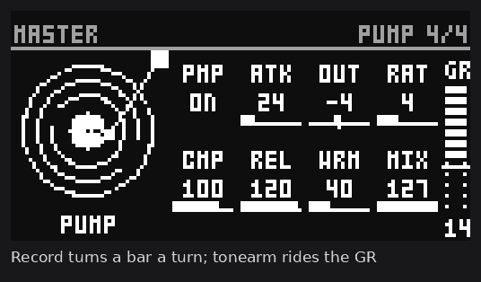

# PUMP

An SP-303 Vinyl Sim-style master compressor for the **Elektron Digitone mk1** (and Digitone Keys), as an
[elekloader](https://github.com/irpina/elekloader) mod (id `pump`). A levelling compressor on everything
the Digitone plays: turn it on and the mix comes up louder, denser and glued, with a pump that breathes
with the beat. It lives on its own master page and is on every output: main outs, headphones and USB.

By Robbie (designed and tested on a Digitone mk1, OS 1.44). GPL-2.0-or-later.



> Unofficial and unsupported. Flashing modified firmware is at your own risk; the stock OS always
> recovers the unit (send the stock .syx from the boot menu).

## What you need

| | |
|---|---|
| Unit | Digitone mk1 or Digitone Keys |
| OS | **1.44** (tested). A 1.43 build is included, untested; on 1.43 there are no drop-down messages and the SETTINGS choice is not kept over a power cycle |
| Mods | elekloader's **core-dn1 4.0** (its insert audio). Not with Tone+FX, which owns the same master page hook |

## Install

Add `elemods/pump-2.10-os1.44.elemod` (or the 1.43 file) in the elekloader app together with core-dn1,
build, and send the firmware to the Digitone. From the command line:

```
python -m elekloader.patch --stock Digitone_and_Digitone_Keys_OS1.44.syx \
  --mod core-4.0-os1.44.elemod --mod pump-2.10-os1.44.elemod --out Digitone_pump.syx
```

## The page

**FUNC + LFO** opens the master pages; **LEFT / RIGHT** to the page after the stock ones. The knobs sit
as on the page: A–D on the top row, E–H below. Settings are saved with each pattern.

| Knob | Name | What it does |
|---|---|---|
| A | PMP | PUMP on or off (a smooth fade; off, it costs nothing) |
| B | ATK | Punch: each hit's first 0–15 ms gets through before the gain comes down |
| C | OUT | Output level before the limiter: −32 to +6 dB, 0 dB in the middle. Turn down for headroom |
| D | RAT | Ratio: AUTO (CMP sets it), then 2:1 up to 20:1, and LIMIT at the top |
| E | CMP | Compression: threshold and make-up (and the ratio, with RAT on AUTO). More is always louder and denser |
| F | REL | Release: LEVEL (slow, smooth) through GLUE to PUMP (fast, breathing) |
| G | WRM | Warmth: drive into a soft saturator, peaks held. Louder and grittier as it rises |
| H | MIX | Parallel blend of the dry and compressed sound |

- **Press a knob and turn**: moves in 8s, from multiple to multiple of 8 (61, 64, 72 ...). **FUNC + turn**: jump to an end.
- **YES**: swap the turning record for a graph of the last 2.8 s of gain reduction, and back.
- The record turns once a bar at the sequencer's tempo and stops with it; the tonearm rides in with the
  gain reduction. The **GR** meter shows it in 2 dB segments with a peak tick.
- Every change shows the stock drop-down message, e.g. *Comp=96*.
- **SETTINGS > PUMP ANIMATION**: untick it for a still page (the controls only, no record, graph or
  meter) and about 1% less CPU. Saved with the project.

Always on while PUMP is: a 30 Hz high-pass in the compressor's detector, so sub-bass you cannot hear does
not drive the pump (the output keeps it), and a soft limiter after OUT that holds peaks under 0 dBFS.

## What it processes

PUMP sits at the end of the Digitone's own master stage, so it takes everything that stage mixes: the
four tracks, the external inputs as the Ext-In mixer has them, chorus, delay, reverb and the master
drive. Its output goes to the codec (main outs and headphones) and to USB's main stereo pair; USB's
separate track and input channels stay as the Digitone made them.

## CPU

Measured on a unit with SYSTEM INFO (irpina's digihealth), four busy tracks: PUMP takes about 5% of the
audio processor (DSP) and 6–7% of the CPU, of which about 2% is core-dn1's insert routing and about 1%
the page animation. WRM costs a little more than the rest. If the Digitone is already near its limit,
lighter reverb, delay and chorus sends free the most.

## How it works

The DSP (`src/pump.c`) runs once a 32-frame block as core-dn1 4.0's insert audio, in one pass: the gain
computer works in a log2 domain from two small tables, with a fast stage (attack 0.5 ms, release 800 ms
to 70 ms) and a slow, programme-dependent leveller, from the previous block's stereo-linked peak; the
gain ramps across the block, then WRM, OUT and the ceiling. No libc, no FPU, no 64-bit products. The page
(`src/pumpctl.c`) adds a kind to the stock master view and draws over it; settings live in an unused
64-byte block of the pattern (MIDI track 3's), so they follow pattern switches and saves. The SETTINGS
row is `src/pumpset.s`.

## Building

With elekloader and an m68k cross GCC on the path:

```
python -m elekloader.sdk.build --stock Digitone_and_Digitone_Keys_OS1.44.syx .
```

## Credits and third-party code

PUMP is Robbie's own work, written with Claude (Anthropic), except for two parts adapted from other
GPL-2.0-or-later projects:

| File | Origin | Licence |
|---|---|---|
| `src/pumpctl.c`: the master-page plumbing (adding a page to the stock master view, its draw slot, the per-pattern store) | Adapted from **Tone+FX**'s `digictl` by Digital Alchemy DSP ([DigiAlchemydsp/RingTone](https://github.com/DigiAlchemydsp/RingTone)) | GPL-2.0-or-later |
| `src/pumpset.s`: the SETTINGS row's four menu callbacks | Adapted from **digihealth**'s SYSTEM INFO row by irpina ([irpina/digihealth](https://github.com/irpina/digihealth)) | GPL-2.0-or-later |

Everything else (`src/pump.c`, `src/pump_tables.h`, `src/pump_sin.h`, the page design and the rest of
`src/pumpctl.c`) is new. The algorithms used are standard textbook ones: a Chamberlin state-variable
filter, Bresenham's line, fixed-point integer maths.

PUMP builds against irpina's [elekloader](https://github.com/irpina/elekloader) SDK headers and runs on its
core-dn1 (GPL-2.0-or-later); neither is included here. The firmware addresses in `mod.json` and the
sources were found by studying the Digitone's own OS so the mod can work with it; no Elektron code is
included. Inspired by the sound of the **Roland SP-303 Vinyl Sim** compressor and Kwazi's free Ableton rack
take on it; no code from either.

## Trademarks

Elektron and Digitone are trademarks of Elektron Music Machines; Roland and SP-303 of Roland Corporation;
Ableton of Ableton AG. They are named only to say what this works with or was inspired by. This project is
not affiliated with or endorsed by any of them.

## Licence

GPL-2.0-or-later, see [LICENSE](LICENSE).
